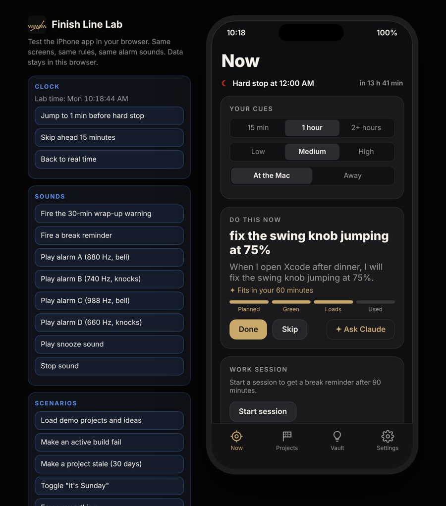
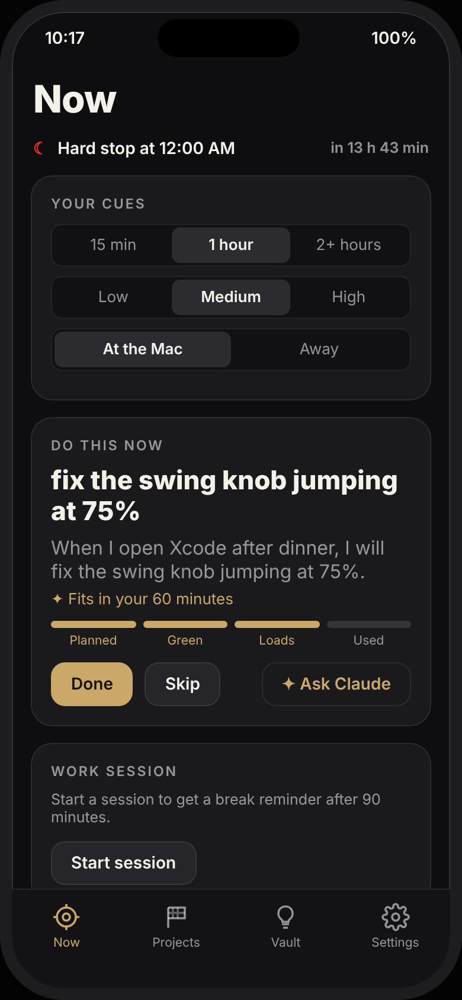
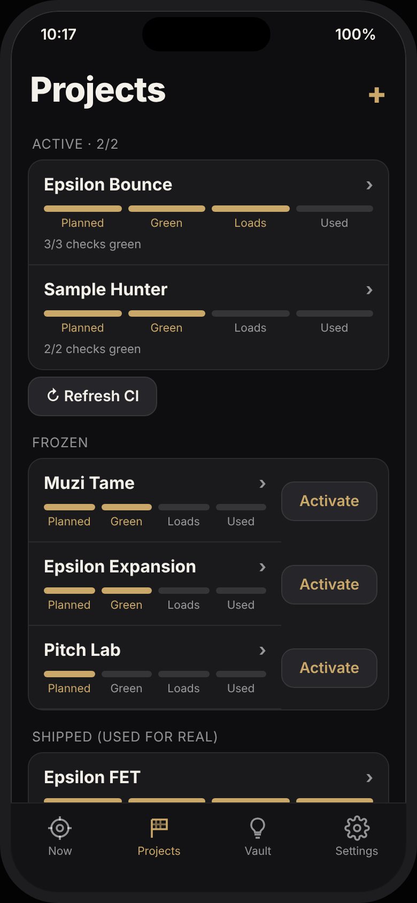
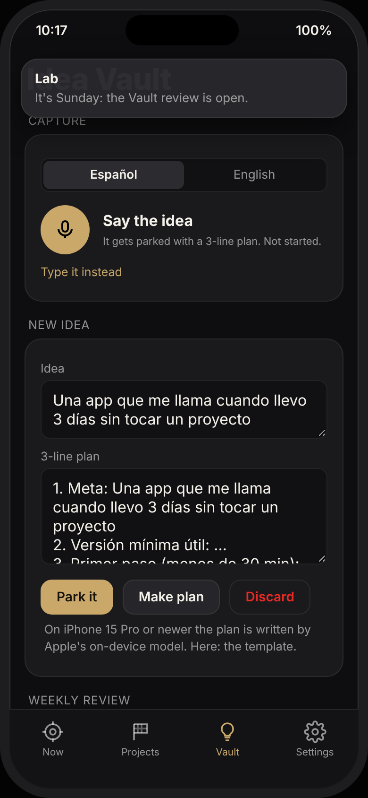
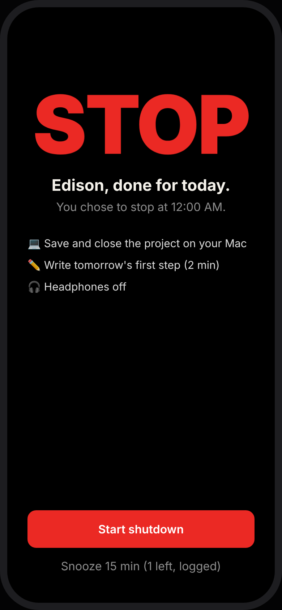

# Finish Line

**Turn starting into finishing.** A personal iPhone app for a creator who starts fast and finishes slow: two active projects at most, every new idea parked instead of started, progress read from GitHub CI, and a loud hard stop before burnout.

**Try it in your browser:** [Web Testing Lab](https://epsilonmuz.github.io/Finish-Line-/) · same screens, same rules, same alarm sounds.



## What it does

| | |
| --- | --- |
|  | **Now:** give three cues (time, energy, at the Mac or away) and get one task. The prioritizer weighs broken builds, how close a project is to its next step and how stale it is, and learns from what you skip. **Ask Claude** opens Claude Code on the repo with the next step typed in. |
|  | **Projects:** two active slots. Activating asks *why this one?*; a third project means a logged swap. Each project climbs a ladder: Planned → Builds green → Loads in my DAW → Used in a real session. Green CI moves the first rung; you confirm the rest. |
|  | **Idea Vault:** say an idea in Spanish or English and it's parked with a 3-line plan, not started. The list opens on Sunday; promote at most one a week. |
|  | **Hard stop:** a 30-minute wrap-up chime, then a loud alarm that breaks through Silent mode, a full-screen STOP, a 2-minute shutdown ritual (write tomorrow's first step) and one logged snooze. Four research-based alarm sounds rotate nightly, and you can mix **your own voice** into the end of them. |

## The science, honestly

Strong evidence: tracking progress yourself (138 randomized studies) and if-then plans ("When I open Xcode after dinner, I will fix X"). Moderate: focusing on a committed goal pushes rivals out of mind; unfinished work leaves attention residue. The 2-project limit and the prioritizer weights are design choices, not proven numbers, which is why swaps are allowed and the prioritizer learns.

## Install on iPhone without Xcode (free)

Every push is built on GitHub's Macs by the **iPhone build** workflow. Pushes to `main` publish `FinishLine.ipa` on the [Releases page](https://github.com/Epsilonmuz/Finish-Line-/releases).

One-time setup (the only time you need the Mac):

1. iPhone: install **LocalDevVPN** from the App Store, and turn on Settings › Privacy & Security › Developer Mode.
2. Mac: download **iloader** from [iloader.app](https://iloader.app), plug in the iPhone, sign in with your Apple ID, click **Install SideStore**.
3. iPhone: open SideStore, connect LocalDevVPN, and finish SideStore's setup.

Then, for every new build:

4. On the iPhone, open the Releases page in Safari, download `FinishLine.ipa`, and open it with SideStore (or SideStore › My Apps › +).
5. Every 7 days: open SideStore with LocalDevVPN on and tap **Refresh All**. No computer.

Free Apple IDs allow 3 sideloaded apps at once, and SideStore counts as one.

## Run the iPhone app from Xcode

1. Double-click `FinishLine.xcodeproj` (Xcode 26, iOS 26 on the phone).
2. Signing & Capabilities › Team: your Apple ID. Change the bundle ID if Xcode says it's taken.
3. Plug in the iPhone, press Run. Allow notifications and the loud alarm.
4. Settings › GitHub: a fine-grained token with **Actions: Read-only**.
5. Settings › **Test the alarm in 1 minute**, then lock the phone.

With a free Apple ID, re-run from Xcode every 7 days.

## Repo layout

```
FinishLine.xcodeproj   open this
FinishLine/            SwiftUI app: App, Models, Services, Views, Resources/Sounds
Config/Info.plist      alarm, microphone and speech permissions
web/                   the web testing lab (deployed to GitHub Pages)
tools/make_alarms.py   generates the alarm sounds (numpy + scipy)
docs/images/           screenshots
```
